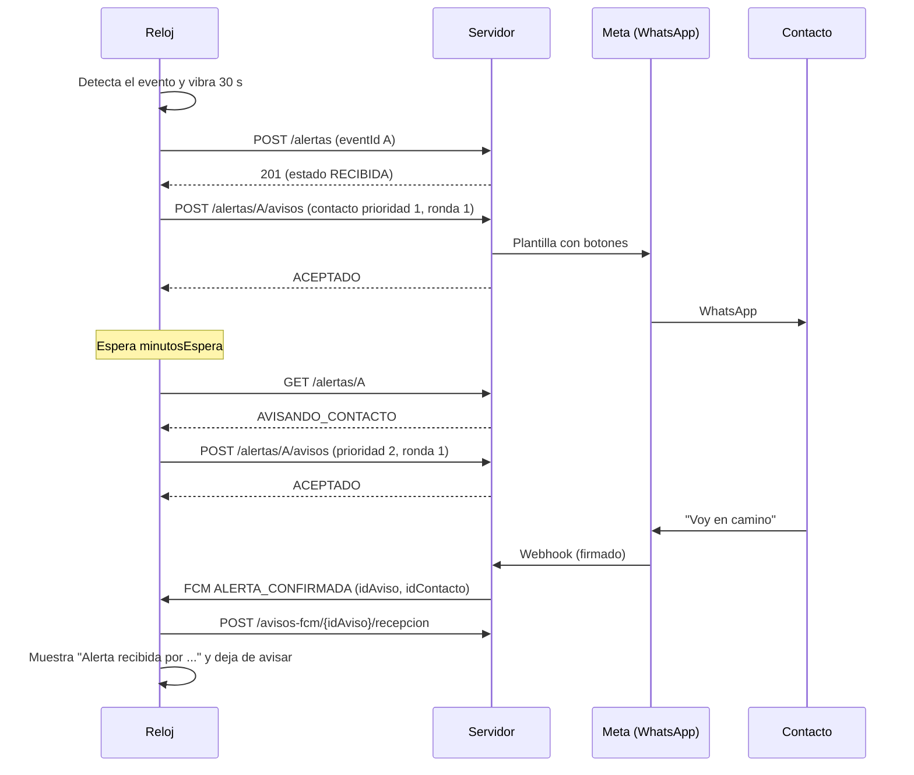

# API del reloj

Contrato entre el reloj (o el simulador) y la plataforma, tareas 0.4.3 a 0.4.7 del [cronograma](cronograma.md). El detalle de cada endpoint y cada campo está en [`api-reloj.yaml`](api-reloj.yaml) (OpenAPI 3.1). Para verlo con formato, abrir el archivo en [editor.swagger.io](https://editor.swagger.io) o en la extensión OpenAPI de VS Code.

**Estado: borrador (versión 0.1.0, 25 de octubre de 2026).** Falta revisarlo con quien desarrolla el reloj (0.4.8). Las preguntas para esa revisión están al final.

## Resumen

| Mensaje | Endpoint | Cuándo |
|---|---|---|
| Sincronización | `POST /api/reloj/v1/sincronizaciones` | Cada 2 h, o al 15 % de batería |
| Configuración | `GET /api/reloj/v1/configuracion` | Si la sincronización o un aviso FCM dice que hay una nueva |
| Alerta | `POST /api/reloj/v1/alertas` | Al terminar la ventana de 30 s sin cancelación |
| Cancelación | `POST /api/reloj/v1/cancelaciones` | Si el paciente canceló dentro de los 30 s (solo métricas) |
| Agravamiento | `POST /api/reloj/v1/alertas/{eventId}/agravamiento` | Caída leve o media que pasa a grave por inmovilidad |
| Solicitud de aviso | `POST /api/reloj/v1/alertas/{eventId}/avisos` | Cada vez que el reloj avisa a un contacto |
| Estado de la alerta | `GET /api/reloj/v1/alertas/{eventId}` | Antes de pasar al siguiente contacto |
| Fin del escalamiento | `POST /api/reloj/v1/alertas/{eventId}/sin-respuesta` | Al terminar la lista dos veces sin confirmación |
| Token de Firebase | `PUT /api/reloj/v1/token-fcm` | Al instalarse y cuando Firebase lo renueva |
| Acuse de aviso FCM | `POST /api/reloj/v1/avisos-fcm/{idAviso}/recepcion` | Apenas llega un aviso de una alerta |
| Avisos FCM (servidor → reloj) | Firebase, esquema `AvisoFcm` | Alerta confirmada o resuelta, simulacro, configuración nueva |
| Webhook de WhatsApp (Meta → servidor) | `GET` y `POST /api/webhooks/whatsapp` | Verificación inicial; respuestas de botones y estados de entrega |

## Flujo de una alerta

Si nadie confirma, el reloj recorre la lista dos veces y termina con `POST /alertas/A/sin-respuesta`. Además, el servidor avisa por correo a la oficina PRLAC, a todos los coordinadores a la vez y en paralelo a este recorrido, sin esperar a los contactos (2.10.5). El reloj no participa en ese aviso.

## Decisiones

- **El reloj se identifica solo con su token.** Es el que se muestra una vez al vincular el reloj (rol DEVICE). De él se deduce la asignación y, de ahí, el paciente: el reloj nunca envía el id del paciente, así que no puede escribir datos de otro. Si el reloj se desvincula o se reemplaza, el token deja de servir y todo responde 401.
- **Las alertas se identifican por el `eventId` del reloj**, no por el id interno del servidor. Si la respuesta de `POST /alertas` se pierde por falta de señal, el reloj igual puede pedir avisos y consultar el estado con el id que ya conoce. Si el servidor todavía no tiene la alerta, responde 404 `ALERTA_DESCONOCIDA` y el reloj la reenvía primero.
- **Todo lo que se reintenta es idempotente.** Sincronizaciones, alertas, cancelaciones y solicitudes de aviso llevan un `eventId` (UUID v4) único en la base. Repetir el mensaje devuelve la misma respuesta. Además, el mismo contacto, canal y ronda no se avisa dos veces aunque llegue con otro `eventId` (por ejemplo, tras reiniciarse el reloj).
- **Una lectura mala no traba la sincronización.** Las lecturas fuera de rango (FC fuera de 20 a 250; SpO2 fuera de 50 a 100), con hora futura o anteriores a la asignación se descartan una por una y se informan en `lecturasRechazadas`. Si se rechazara el lote completo, el reloj lo reintentaría para siempre. Las lecturas repetidas se ignoran sin error (`lecturasRepetidas`).
- **Una alerta nunca se rechaza por su contenido.** Si la evidencia no calza con la configuración vigente, el servidor la acepta y marca la discrepancia (2.1.2). Solo responde 400 si el mensaje está mal formado (falta un campo, un tipo no existe); eso es un error de programación del reloj, y el reloj debe mostrar "No se pudo avisar".
- **La cancelación es un mensaje aparte.** Una alerta cancelada nunca se envió como alerta; se informa después, cuando haya conexión, solo para métricas.
- **El agravamiento actualiza la alerta existente** (2.1.3): no crea otra. Solo vale para caídas leves o medias, no canceladas; repetirlo no cambia la hora. Guarda también los segundos de inmovilidad.
- **Discrepancias** (2.1.2): el servidor compara cada alerta con la configuración vigente (versión, módulo activo, gravedad configurada de tendencia y zona, y que las lecturas superen los umbrales). Si algo no calza, la acepta igual y guarda la discrepancia para el equipo; el reloj no recibe nada distinto.
- **Exceso de alertas** (2.1.4): desde la 10.ª alerta de un reloj (sin contar cancelaciones) en 60 minutos, el servidor las acepta todas y crea una alerta técnica `EXCESO_ALERTAS`, leve, para revisar el reloj. Nunca responde 429 por esto.
- **Hora del reloj desfasada:** se acepta igual. Si la diferencia con el servidor supera 120 s, la respuesta de la sincronización la informa (`desfaseRelojSegundos`) y el dashboard la muestra.
- **Configuración por versión.** La `version` es un hash del contenido, el mismo que guarda la base (`hash_configuracion`). Cambia con cualquier dato, incluso el nombre o el horario de un contacto. La sincronización avisa si el reloj tiene una versión distinta (`configuracionNueva`); el reloj la descarga con `GET /configuracion` y `If-None-Match`, y el servidor responde 304 si ya es la vigente. Así no viaja en cada sincronización.
- **La configuración trae todo para trabajar sin conexión:** módulos, umbrales (con los valores base si el paciente no tiene ajustes), plazo de espera, contactos, horario hábil y feriados. Los contactos van sin número ni correo: el reloj pide los avisos por `idContacto` (el vínculo `contacto_paciente`) y el servidor elige el número o el correo.
- **Un aviso rechazado no es un error.** Si el contacto no tiene opt-in, está inactivo o no es del paciente, la respuesta es 200 con `RECHAZADO` y el motivo, y el reloj pasa al siguiente. Cada respuesta trae el estado de la alerta: si ya está confirmada, resuelta o cancelada, `detenerEscalamiento` es `true`.
- **`ACEPTADO` no significa entregado.** El servidor lo envía por WhatsApp y, si falla, intenta por correo (2.9.7). Las entregas y lecturas quedan en la línea de tiempo del dashboard; el reloj no las necesita.
- **Acuse inmediato de los avisos FCM.** El reloj confirma cada aviso de una alerta apenas llega, con su `idAviso`. Si no llega en un plazo, el servidor lo reintenta (2.3.3). Esperar a la siguiente sincronización (hasta 2 h) no serviría para eso. Los avisos `CONFIGURACION_NUEVA` no se acusan: se nota cuando el reloj la descarga.
- **Los avisos FCM no llevan datos de salud**, solo el tipo y los identificadores.
- **Errores en el mismo formato que el dashboard** (RFC 9457), con un `codigo` estable para que el reloj decida sin leer el texto.
- **Límites:** hasta 2.000 lecturas y 2.000 ubicaciones por lote (14 días de lecturas cada 30 min son unas 1.350). Si el reloj necesita reenviar más, parte el historial en varios lotes. El límite de frecuencia (429 con `Retry-After`) lo aplica Nginx (4.1.2).
- **Ruta versionada (`/api/reloj/v1`).** Un cambio incompatible se publica como `v2` sin dejar de atender a los relojes que no se han actualizado.

## Qué guarda cada mensaje

| Mensaje | Tablas |
|---|---|
| Sincronización | `sincronizacion`, `registro_vital`, `ubicacion`, `evento_descartado` |
| Alerta, cancelación y agravamiento | `alerta` (el estado lo calcula la vista `alerta_estado`) y `discrepancia_alerta` |
| Solicitud de aviso | `registro_intento` |
| Webhook de WhatsApp | `registro_intento` (entrega, lectura, fallo y respuesta) |
| Fin del escalamiento | `alerta.fecha_hora_sin_respuesta` |
| Token de Firebase | `smartwatch.token_fcm` |
| Acuse de aviso FCM | `aviso_fcm.fecha_hora_recepcion` |
| Configuración | Se arma con `configuracion`, `umbral`, `contacto_paciente` y los valores base del backend |

## Lo que el reloj debe hacer

- Guardar cada mensaje en su cola local **antes** de enviarlo, con su `eventId` ya generado, y reintentarlo con el mismo `eventId` hasta recibir una respuesta 2xx.
- Ante 400: no reintentar ese mensaje; registrarlo y, si es una alerta, mostrar "No se pudo avisar".
- Ante 401: dejar de enviar y mostrar que el reloj está desvinculado.
- Ante 404 `ALERTA_DESCONOCIDA`: reenviar primero la alerta y luego repetir el mensaje.
- Ante 429 o 5xx, o sin red: reintentar más tarde (respetando `Retry-After` si viene).
- Enviar las horas en UTC; las horas de los contactos y del calendario vienen en hora local de Chile (`America/Santiago`).

## Preguntas para la revisión con quien desarrolla el reloj (0.4.8)

1. **Simulacro:** propuesta: el servidor crea la alerta de prueba y manda el aviso FCM `SIMULACRO` con su `eventIdAlerta`; el reloj muestra "PRUEBA" y escala como siempre con ese `eventId`, y el servidor usa la plantilla "PRUEBA". ¿Le sirve, o el servidor debe avisar solo, sin pasar por el reloj?
2. ¿El reloj puede enviar alertas `BATERIA_BAJA` y `RELOJ_NO_PUESTO`, o esas las detecta solo el servidor con la sincronización (2.2.4)?
3. ¿Cuánto tarda en llegar un aviso FCM por LTE en la prueba de factibilidad? Define el plazo para reintentarlo.
4. ¿El reloj puede guardar la cola y los temporizadores de forma que sobrevivan a un reinicio (Room)?
5. ¿Los rangos válidos de las lecturas (FC de 20 a 250 y SpO2 de 50 a 100) calzan con lo que entrega el Samsung Health Sensor SDK?
6. ¿Le basta la `version` como hash, o prefiere además un número correlativo para mostrar en pantalla?
7. La matriz FC × SpO2 queda pendiente del Anexo B (equipo clínico); por ahora solo viaja `reglas.versionMatriz`.
8. **Regla de tendencia (`reglas.tendencia`, 05-11-2026):** el reloj alerta cuando FC o SpO2 lleva ese tiempo fuera de su rango normal, sin llegar al límite grave; la regla de 2 lecturas consecutivas queda solo para los valores más allá del límite grave. Definido: la alerta usa la gravedad de `reglas.tendencia.severidad` (hoy `MEDIA`), sin fijarla en el código del reloj; si una lectura vuelve al rango normal, el tiempo parte de cero; con los umbrales de cada paciente, `normalMin` y `normalMax` son normales, y `graveBajo` y `graveAlto` son zona intermedia. Definido además (05-11-2026): una sola alerta mientras el valor siga en esa zona; puede volver a alertar solo después de que una lectura vuelva al rango normal (sujeto a validación del equipo clínico).
9. **Zona segura (`zonaSegura`, 05-11-2026):** viene solo con `modulos.zonaSegura` activo (y entonces `gpsActivo` es `true`). El reloj compara su GPS con el círculo (`latitud`, `longitud`, `radioMetros`) y, si la persona sale, envía una alerta `ZONA_SEGURA` con `zonaSegura.severidad` (media por defecto; se elige por paciente). Por definir con quien desarrolla el reloj: cada cuánto revisa el GPS (afecta la batería, por eso la zona se había eliminado en la v7), cuántas posiciones fuera del círculo exige antes de alertar (el GPS puede saltar) y si vuelve a alertar después de que la persona regresa.
10. **Botón de ayuda (`modulos.botonAyuda`, 05-11-2026):** el reloj muestra un botón para pedir ayuda. Al presionarlo envía una alerta `BOTON_AYUDA` siempre `LEVE`, con la ventana de 30 s para cancelar. Como toda leve, fuera del horario hábil espera al día hábil. Avisa primero a los contactos con `tipo` `VECINO`, por prioridad, y después al resto, por prioridad. Por definir: dónde va el botón en la pantalla y cómo evitar que se presione por error.

## Pendiente

- Ya implementados: sincronización, alertas, cancelaciones y estado de una alerta (25-10-2026, tarea 1.4); configuración y token de Firebase (27-10-2026, tarea 1.7). Detalle en [backend.md](backend.md#api-del-reloj).
- Implementado el 05-11-2026 (tarea 2.1): agravamiento, discrepancias y exceso de alertas.
- Por implementar: 2.3 (avisos FCM y acuse), 2.9 (webhook) y 2.10 (solicitud de aviso y fin del escalamiento).
- Definir con TI el subdominio público (0.8); en el contrato figura uno de ejemplo.
